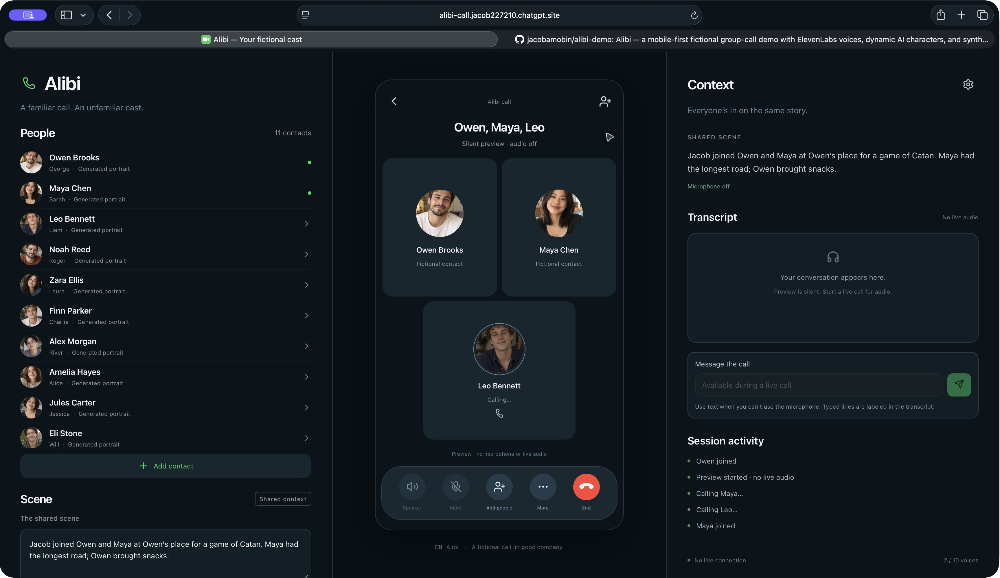
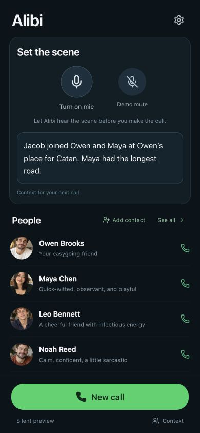
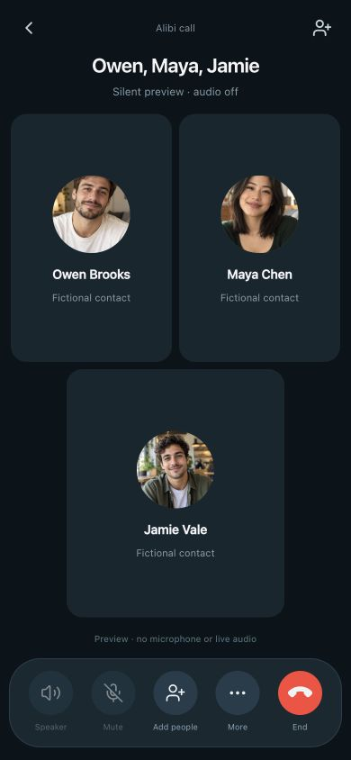
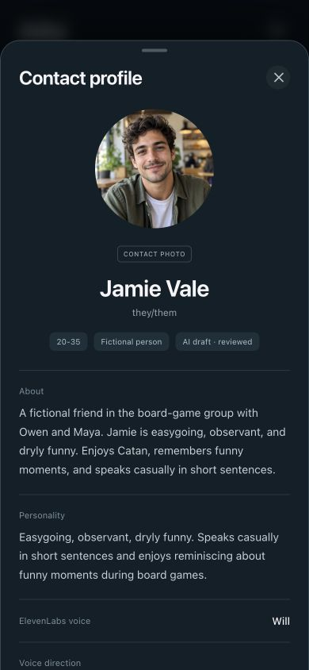

# Alibi

A fictional ensemble call, with a WhatsApp-style web interface. Built with React and Next.js as a static export. No application backend.

On desktop the call sits in the middle third, with People and Scene on the left and Context, Transcript, and Session activity on the right. On phone the call fills the screen and supporting controls open in sheets.

- Ten fictional contacts with ImageGen portraits: Owen, Maya, Leo, Noah, Zara, Finn, Alex, Amelia, Jules, and Eli.
- Invented people use monograms, individual personalities, and distinct prepared ElevenLabs voices.
- Turn on the home-screen microphone to gather context before New call. Captured speech becomes the scene and is included automatically when calling.
- Demo mute stops context capture and carries into a muted call. Live user speech updates the scene; the agent can replace it with a concise summary.
- One ElevenLabs live agent performs the cast, with up to 10 voices including the default.
- Characters can suggest inviting other fictional people and wait for Jacob’s agreement. They announce the call before a short simulated ring, then the new person picks up. An unnamed role such as a DJ can become a new full-name character with an individual personality and available voice.
- With an OpenAI key, newly invented people receive a synthetic portrait in the background. Monograms and live voices work immediately. Image jobs are bounded, deduplicated and cancelled when the call ends. Failed images keep the monogram.
- Context includes a typed Message the call fallback for accessibility and reproducible demos; typed lines are labeled separately from microphone transcription.
- Call audio drives one shared spectrum meter below the participants. Characters greet Jacob and allow quiet moments naturally.
- Preview mode is silent and explicitly labeled. Portraits are static; there is no generated video.
- API keys stay in the current tab's memory. Non-secret agent IDs and fictional character profiles are stored locally.
- Add your own contact persona with a photo and short bio, or import one .vcf contact. Review, edit, save, call and invite it. Custom profiles and compressed portraits are stored in this browser’s IndexedDB.
- Optional OpenAI drafting estimates a broad age range and suggests a personality and a prepared ElevenLabs voice. Pronouns and heritage are explicit editable details; the app does not infer race, ethnicity, nationality or gender identity from a face. Voice suggestions use sound preferences and the bio. Imported phone numbers and email addresses are discarded.

## Screenshots

Desktop Safari: the call in the middle third, with scene context and session activity alongside. This silent preview captures Leo ringing before pickup.



<table>
  <tr>
    <th>Set the scene</th>
    <th>Group call</th>
    <th>AI-drafted contact</th>
  </tr>
  <tr>
    <td></td>
    <td></td>
    <td></td>
  </tr>
</table>

Phone images use a 390 × 844 responsive browser viewport. The group call is a silent layout preview; Jamie’s saved profile was drafted with OpenAI from the synthetic demo photo and bio.

## Run locally

Node.js 22.18+ (or a newer Node version with TypeScript stripping) and npm are required.

```sh
npm ci
npm run dev
```

Open `http://localhost:3000`. An iPhone needs an HTTPS deployment for microphone access; plain HTTP to a LAN IP is insufficient.

```sh
npm test
npm run typecheck
npm run build
```

The production static export is copied to `out/`. There are no API routes or hosted provider secrets.

## Live setup

1. Open Settings and enter your ElevenLabs API key directly in the app.
2. Select **Prepare Alibi agent**. This verifies the ten selected voices and creates four client tools and a dedicated private agent in your ElevenLabs account.
3. On the home screen, tap **Turn on mic**, allow microphone access, and speak naturally to establish the scene. Demo mute pauses capture.
4. Select **New call**. The captured context is included automatically.
5. Say “Let's call Maya” or use Add. Maya rings, joins, and receives her assigned voice. Add Leo to demonstrate three participants.
6. Ask Owen to bring in someone new. An invented character gets a monogram and unused prepared voice.

Your key needs permissions for voices, agents, tools, and conversation tokens, and Speech-to-Text single-use tokens for scene capture. Live calls consume your provider credits. This agent disables voice recording and configures seven-day transcript retention. OpenAI is optional: enter a key in Settings or Add contact to use Draft with AI. The explicit action sends only the selected thumbnail and draft details to OpenAI Responses (gpt-4.1-mini, store:false). Manual creation works without it. Portraits never enter ElevenLabs agent prompts or tool responses.

On iPhone, export one person from Contacts → Share Contact → Save to Files, then choose the .vcf in Add contact. The browser does not have automatic address-book access. JPEG/PNG embedded photos are supported; otherwise choose a photo separately. A suggested voice is preferred: if that slot is occupied, another distinct prepared voice is used for the group call.


See the [web design](docs/superpowers/specs/2026-11-01-alibi-web-design.md).
